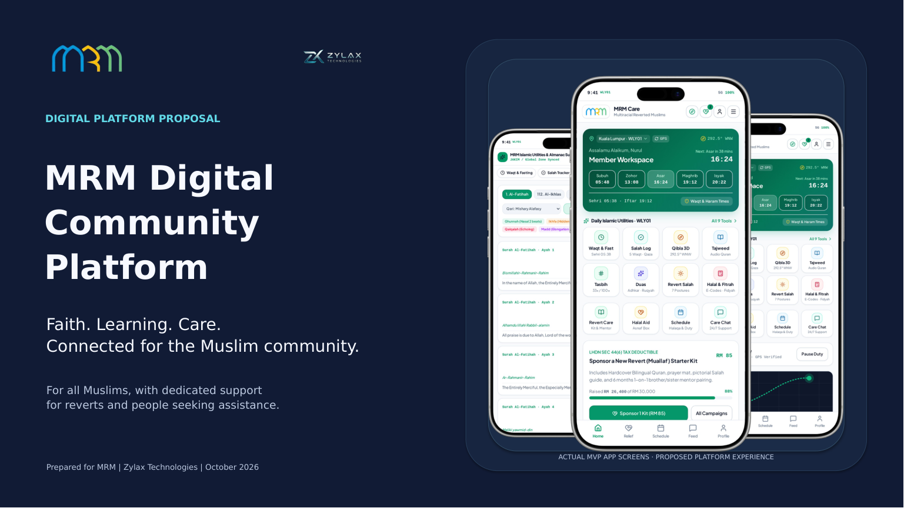

# MRM Digital Community Platform — complete client proposal

**Use this edition for the client presentation.** It is one complete 85-slide deck with an app-screenshot cover, a professional introduction, connected user journeys, complete feature detail and a delivery conclusion. It supersedes the earlier 96-page assembly.

- [Download the editable PowerPoint](MRM_Complete_Client_Proposal.pptx)
- [View or download the PDF](MRM_Complete_Client_Proposal.pdf)
- [Download the complete bundle](MRM_Client_Proposal_Download.zip)
- [Preview the cover](previews/Cover.png)

On GitHub, open the file and choose **Download raw file**.



## Presentation structure

| Slides | Section |
| --- | --- |
| 01–05 | Cover, executive proposition, audiences, connected experience and clickable presentation guide |
| 06–07 | Complete teacher and seeker journeys |
| 08–22 | Fifteen feature-to-feature user journeys, including motivations, handoffs and reciprocal value |
| 23 | Shared service foundation |
| 24–70 | Forty-seven core capability explanations and feature maps |
| 71–74 | End-to-end care, learning, daily-use and shared-event services |
| 75–79 | Five extended campaign, impact and contribution concepts for separate agreement |
| 80–83 | Delivery sequence, ownership, acceptance and priorities |
| 84–85 | Core scope, commercial principles and next steps |

The opening is written for MRM and its stakeholders. It introduces the platform before explaining its internals. All slides use one global page-number system. The presentation guide, feature links and footer navigation route to the correct pages in the new order. Speaker notes retain source qualifications and design decisions.

## Screenshot use

The cover uses three distinct actual MVP captures: Quran, volunteer workspace and member workspace. They intentionally recur where their features are explained. Across the full presentation there are **41 unique screenshot sources and 44 placements**, with no accidental duplicate slide assembly. Internal navigation/developer captures and source-audit slides are kept outside the client narrative. The earlier [48-image audit](../strategic-rebuild/Screen_Audit.md) remains available for reference. Payment captures containing full identity numbers are not used.

Screens show MVP states. Proposed invitations, referrals, approvals and service integrations require implementation and validation. The all-Muslim audience, specialised revert support, teacher-only subscription scope and free core assistance/volunteering remain explicit. Extended collection/payment concepts remain separate scope decisions.

## Verification and review

The PDF was rendered from this exact PowerPoint, not assembled from separate PDF exports. Checks passed for all 85 pages, missing native text, page boundaries, new opening/closing textboxes, global numbering and 792 internal links. The cover contains three separate app images. [Verification results](Verification.json) · [Slide assembly trace](Assembly_Model.json) · [Screenshot register](Image_Use_Register.json).

- [Executive summary](previews/Executive_Summary.png)
- [Connected platform](previews/Connected_Platform.png)
- [Teacher-to-volunteer bridge](previews/Teacher_Volunteer_Bridge.png)
- [Closing](previews/Closing.png)
- [Contact sheets for every slide](previews)

Install DejaVu Sans and DejaVu Sans Bold for faithful PowerPoint editing. The PDF preserves the exported typography.

## Rebuild

Run from the repository root using the Python and LibreOffice environment used for the prior editions. `MRM_SCREENSHOT_DIR` can point to the corrected screenshot directory or resized display copies; the source defaults to the display copies in the existing workspace.

```bash
python presentations/client-proposal/source/build_client_deck.py
soffice -env:UserInstallation=file:///tmp/mrm-client-lo --headless --convert-to pdf --outdir presentations/client-proposal presentations/client-proposal/MRM_Complete_Client_Proposal.pptx
python presentations/client-proposal/source/verify_export.py
python presentations/client-proposal/source/package_deck.py
```

The builder reuses the existing editable diagrams and their links, assembles the new narrative, adds the cover and client opening/closing, then replaces section-local footers. It does not change application code.
