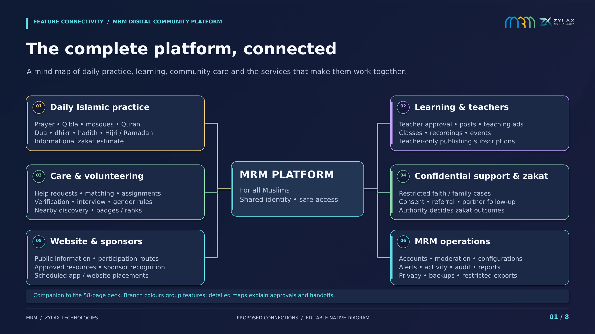

# MRM feature-connectivity mind maps

The platform is for **all Muslims**, with dedicated MRM revert-support services.

The updated presentation retains the original 50 feature pages and adds **eight connectivity pages**, giving a **58-page deck**. All diagram nodes, labels and connectors are editable in PowerPoint. The full deck contains clickable feature links and PDF bookmarks.

## Downloads

- [Updated full deck: 58-page PDF](MRM_Connected_Platform_58_Pages.pdf)
- [Updated full deck: editable PowerPoint](MRM_Connected_Platform_58_Pages.pptx)
- [Only the eight connectivity maps: PDF](MRM_Feature_Connectivity_8_Maps.pdf)
- [Only the eight maps: editable PowerPoint](MRM_Feature_Connectivity_8_Maps.pptx)
- [Master feature mind map: one-page PDF](MRM_Master_Feature_Mindmap.pdf)
- [Download bundle: decks, PNGs and SVGs](MRM_Connectivity_Download.zip)

For any binary file, open it and choose **Download raw file** in GitHub.

## Master feature mind map



## All eight diagrams

| Map | Full deck page | Image / vector |
| --- | --- | --- |
| Master platform mind map | 51 | [PNG](previews/01_Master_Platform_Mindmap.png) · [SVG](vectors/01_Master_Platform_Mindmap.svg) |
| Muslim user journeys | 52 | [PNG](previews/02_Muslim_User_Journeys.png) · [SVG](vectors/02_Muslim_User_Journeys.svg) |
| Care and volunteer connections | 53 | [PNG](previews/03_Care_and_Volunteer_Connections.png) · [SVG](vectors/03_Care_and_Volunteer_Connections.svg) |
| Teacher-to-learning connections | 54 | [PNG](previews/04_Teacher_to_Learning_Connections.png) · [SVG](vectors/04_Teacher_to_Learning_Connections.svg) |
| Islamic utility dependencies | 55 | [PNG](previews/05_Islamic_Utility_Dependencies.png) · [SVG](vectors/05_Islamic_Utility_Dependencies.svg) |
| Confidential support and zakat | 56 | [PNG](previews/06_Confidential_Support_and_Zakat.png) · [SVG](vectors/06_Confidential_Support_and_Zakat.svg) |
| MRM operations connections | 57 | [PNG](previews/07_MRM_Operations_Connections.png) · [SVG](vectors/07_MRM_Operations_Connections.svg) |
| Feature connection index | 58 | [PNG](previews/08_Feature_Connection_Index.png) · [SVG](vectors/08_Feature_Connection_Index.svg) |

[View all eight diagrams together](previews/All_8_Maps_Overview.jpg).

The master mind map groups capability families. Detailed diagrams show directed handoffs and dependencies; dashed arrows indicate a conditional path or revision feedback. Connections do not imply unrestricted data sharing.

Teacher approval, subscription entitlement and content moderation remain separate checks. Core member assistance and volunteer participation remain free. Confidential cases stay restricted; zakat eligibility and disbursement remain authority decisions. Marketplace remains excluded.

These diagrams describe proposed service relationships from the supplied documents. They do not certify implemented application behaviour. Original screenshots, the original 50-page deck and its evidence register remain in the parent directory.

## Rebuild and verification

The environment already provides Python 3, `python-pptx`, Pillow, PyMuPDF, LibreOffice and DejaVu Sans fonts. No new service, credential or package installation was needed.

From the repository root:

```bash
python presentations/connectivity/source/build_connectivity.py
soffice -env:UserInstallation=file:///tmp/mrm-connectivity-lo --headless --convert-to pdf --outdir presentations/connectivity presentations/connectivity/MRM_Feature_Connectivity_8_Maps.pptx presentations/connectivity/MRM_Connected_Platform_58_Pages.pptx
python presentations/connectivity/source/export_and_verify.py
```

The export script verifies page counts, retained text, shape bounds, internal navigation, non-overlapping map nodes and edges that avoid unrelated nodes. PNGs are 2560 × 1440; SVGs preserve vector geometry. [Verification results](Verification.json).
