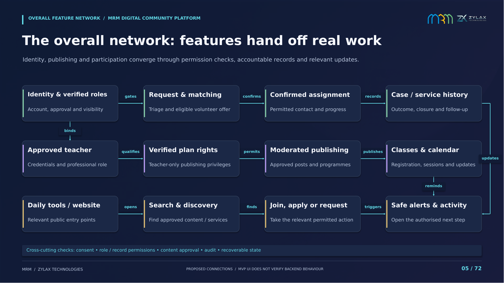

# MRM: detailed feature-to-feature strategy and MVP presentation

A rebuilt **72-page presentation** supported by **52 individual feature-connection maps**. The platform serves **all Muslims**, with specialised MRM revert-support services.

Every feature map identifies concrete connected capabilities, names the handoffs, explains the value of the connection and states what should be verified. The overall and end-to-end diagrams connect actual features; they do not use MRM as a generic central hub.

## Download the deliverables

- [Full presentation: 72-page PDF](MRM_Strategic_Platform_72_Pages.pdf)
- [Full presentation: editable PowerPoint](MRM_Strategic_Platform_72_Pages.pptx)
- [Detailed feature atlas: 52-map PDF](MRM_Detailed_Feature_Atlas_52_Maps.pdf)
- [Detailed feature atlas: editable PowerPoint](MRM_Detailed_Feature_Atlas_52_Maps.pptx)
- [Complete deck and atlas download bundle](MRM_Complete_Rebuild.zip)
- [Offline interactive feature explorer](Interactive_Feature_Explorer.html)

Open a binary file in GitHub and choose **Download raw file**. To use the interactive explorer, download the HTML file and open it in a browser. It requires no server, external library or account.

## Overall feature network



## How to use the deck

| Section | Pages | Purpose |
| --- | --- | --- |
| Vision, value, audience and overall network | 01–05 | Explain why the connected platform matters. |
| Individual feature networks | 06–52 | Explore 47 primary capability maps, including daily utilities, care, learning, subscriptions and operations. |
| Connected service journeys | 53–56 | Follow care, teaching, everyday Muslim use and shared event delivery. |
| Extended financial and impact concepts | 57–61 | Five separate maps for campaign discovery, provisions, impact, allocation and authorised payment. |
| Delivery, ownership and acceptance | 62–65 | Establish dependencies, responsibilities and meaningful validation. |
| Evidence, image audit, index and decisions | 66–72 | Trace source images, navigate features and resolve remaining decisions. |

Use the slide-03 contents page, PDF bookmarks and clickable feature boxes to navigate. The atlas enlarges the diagrams and provides its own feature-to-feature links. [All 52 standalone PNGs](maps) and [SVG vector diagrams](vectors) are available separately.

## Corrected screenshot review

All **48 images in the corrected Drive folder** were visually inspected and OCR-reviewed. The withdrawn ZIP was not used. There are **45 distinct screenshot uses, each used once**. Two payment/receipt captures containing a full identity number and one developer installation screen are excluded from feature imagery.

Roles, tabs, modal states and the dark theme are labelled for their actual content. Generic names such as catalog, product and cart are explained as relief campaigns, campaign provisions and donation allocations. They are not presented as a marketplace. The Quran capture is correctly described as Al-Fatihah despite its conflicting selected-tab label; the Qibla capture is identified as a simulation. [Complete screenshot audit](Screen_Audit.md) · [Machine-readable register](Screen_Audit.json).

Screenshots show MVP states rather than verified runtime behaviour. Their statistical, tax/audit, testimonial, certification, encryption and source-sync claims are not endorsed as proven facts. The payment concepts are explicitly separated from the earlier proposal, which excludes zakat collection/disbursement. Teacher-only subscriptions, free core member/volunteer services, restricted case access and marketplace exclusion remain explicit.

## Review the visuals

- [Cover](previews/Cover.png)
- [Overall network](previews/Overall_Feature_Network.png)
- [End-to-end care](previews/Care_Journey.png)
- [End-to-end learning](previews/Learning_Journey.png)
- [Full-deck and atlas contact sheets](previews)
- [Verification results](Verification.json)

## Verification

The final exports were checked for missing text, page boundaries, overlapping feature boxes, arrow routes through unrelated boxes, and repeated screenshot media. All checks passed. The main PDF has 844 internal navigation links; the atlas has 676. Its 52 maps contain 289 labelled local relationships, including relationships repeated across related maps. All 52 explorer selections, cross-feature navigation and search were tested in Chromium with no JavaScript errors.

[Browser verification](Browser_Verification.json) · [Interactive explorer preview](previews/Interactive_Explorer.png)

For faithful PowerPoint editing, install DejaVu Sans and DejaVu Sans Bold. The PDFs preserve the intended typography.

## Rebuild

Tools used: Python 3, python-pptx, Pillow, PyMuPDF, DejaVu Sans and LibreOffice. These were available in the cloud environment. The original user-selected template and source strategy are not replaced by this presentation work.

Place the corrected 48 PNG files in a local directory, then run from the repository root:

```bash
export MRM_SCREENSHOT_DIR=/absolute/path/to/corrected-screens
python presentations/strategic-rebuild/source/build_deck.py
python presentations/strategic-rebuild/source/audit_images.py
python presentations/strategic-rebuild/source/explorer.py
soffice -env:UserInstallation=file:///tmp/mrm-strategic-lo --headless --convert-to pdf --outdir presentations/strategic-rebuild presentations/strategic-rebuild/MRM_Detailed_Feature_Atlas_52_Maps.pptx presentations/strategic-rebuild/MRM_Strategic_Platform_72_Pages.pptx
python presentations/strategic-rebuild/source/export_verify.py
```

The audit script recomputes source and content-region hashes from the corrected local files; public audit results contain no OCR transcript of withheld identity data. Source PNGs remain outside the repository. Display copies preserve their content, proportions and transparency at 900 pixels wide for high-resolution slides with a practical file size.
