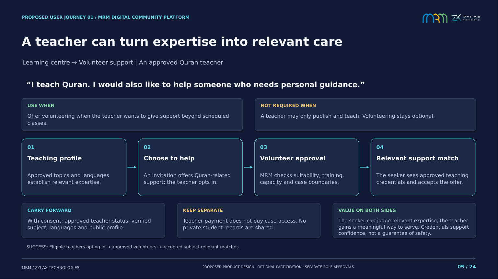
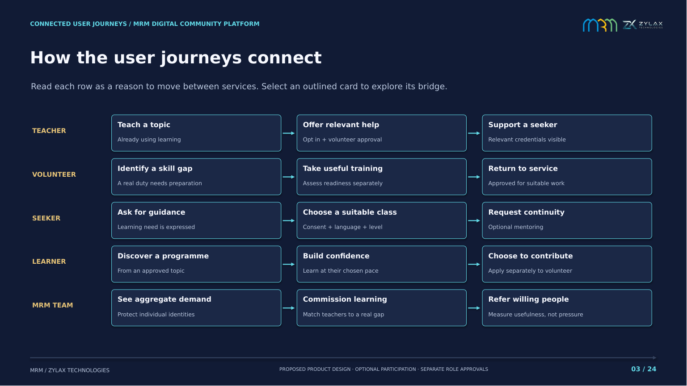

# MRM: why people move between features

The connection story now starts with a person's goal: **why would someone using one feature choose to use another?** The new 24-page section answers that question with 15 proposed user-value bridges and two complete journeys. The existing 72-page feature explanation is preserved after it in the complete 96-page presentation.

## Download

- [Complete 96-page presentation — PDF](MRM_Complete_Connected_Platform_96_Pages.pdf)
- [Complete 96-page presentation — editable PowerPoint](MRM_Complete_Connected_Platform_96_Pages.pptx)
- [New connection section only — 24-page PDF](MRM_User_Value_Bridges_24_Pages.pdf)
- [New connection section only — editable PowerPoint](MRM_User_Value_Bridges_24_Pages.pptx)
- [Download bundle](MRM_User_Journeys_Download.zip)

Open a file on GitHub and select **Download raw file**. DejaVu Sans and DejaVu Sans Bold preserve the intended typography when editing the PowerPoint. The PDFs preserve the intended rendering.

## The teacher example



An approved Quran teacher does not need volunteering to teach. If they want to give support, the app can invite them to opt in, carry over consented approved subject expertise, and complete separate volunteer approval. A relevant seeker can then see that the proposed helper is also an approved Quran teacher. That is evidence of relevant expertise, not a guarantee of safety. The seeker still chooses whether to accept; private case access depends on the approved relationship.

The reverse connection also matters: a volunteer who needs preparation can enter suitable training, have readiness assessed separately, and return to eligible duties. A seeker who wants Quran guidance can choose a suitable class, with only the selected learning goal and necessary referral context carried over. Assistance never depends on joining a class.

## Connected user journeys



Every bridge identifies the person and their motivation, when the connection is useful and when it is unnecessary, a four-step flow, the information carried forward, what stays separate, reciprocal benefits, and a meaningful success signal.

| Connection-section page | Proposed bridge |
| --- | --- |
| 05 | Approved teacher → optional relevant volunteer support |
| 06 | Volunteer skill gap → approved learning → assessed return to duty |
| 07 | Seeker's learning need → consented programme referral |
| 08 | Quran reading goal → relevant class → return to practice |
| 09 | Learning → requested ongoing mentoring |
| 10 | Mentoring → consented support referral |
| 11 | Learning event → separately accepted volunteer duty |
| 12 | Approved topic post → relevant programme |
| 13 | Aggregate support demand → programme planning |
| 14 | Verified outcome → optional consented story → participation |
| 15 | Selected mosque or area → requested local programme discovery |
| 16 | Learner's wish to contribute → separate volunteer application |
| 17 | Volunteer competence boundary → authorised specialist referral |
| 18 | Public website destination → continued app journey |
| 19 | Private volunteer development review → useful learning |

Pages 20–21 follow the teacher and seeker across complete journeys. Pages 22–24 cover sequencing, independent role approvals, shared context and acceptance decisions. Clickable journey cards and PDF bookmarks provide navigation.

## Scope and evidence

These bridges are **product design proposals**, not claims that the MVP already implements them. Invitation timing, credentials, referral ownership, consent and eligibility rules need validation with teachers, volunteers, seekers and MRM. The deck retains all-Muslim positioning, specialist revert support, teacher-only subscription scope, free core assistance/volunteering and marketplace exclusion from the existing presentation.

The original 72 pages remain text-identical in the complete PDF. The 45 unique corrected screenshots are still used once each; the new section adds no screenshot repeats. Combined slide footers keep local section numbering: 01–24 for connections and 01–72 for feature detail. PDF bookmarks and internal navigation point to the actual destinations in the combined document.

[Verification results](Verification.json) · [All new pages as contact sheets](previews) · [Editable bridge model](Bridge_Model.json)

## Rebuild

From the repository root, with Python dependencies and LibreOffice from the existing deck environment:

```bash
python presentations/strategic-rebuild/user-journeys/source/build_bridges.py
python presentations/strategic-rebuild/user-journeys/source/merge_decks.py
soffice -env:UserInstallation=file:///tmp/mrm-bridges-lo --headless --convert-to pdf --outdir presentations/strategic-rebuild/user-journeys presentations/strategic-rebuild/user-journeys/MRM_User_Value_Bridges_24_Pages.pptx
python presentations/strategic-rebuild/user-journeys/source/export_bridges.py
python presentations/strategic-rebuild/user-journeys/source/package_bridges.py
```

The merge preserves editable shapes, images and slide hyperlinks. The export rebuilds PDF navigation against the combined slide IDs and checks missing text, new textboxes, boundaries and unchanged original content.
